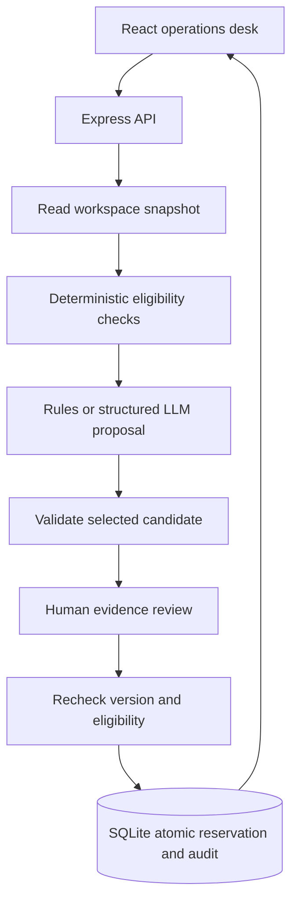

# ShiftPilot

**Coverage, with confidence.** An evidence-first workspace for turning an open shift into a reviewed staffing decision.

TypeScript · React · Node.js · SQLite · optional OpenAI Responses API

## The problem

A worker calls out. A coordinator must check qualifications, availability, overlapping assignments, and budget before finding a replacement. A plausible AI answer is not enough: the recommendation must be supported by current data, and committing it must not double-book anyone.

ShiftPilot demonstrates that complete product slice: request → constraint checks → recommendation → evidence review → human approval → atomic reservation and audit record.

This is a new, AI-assisted portfolio prototype using entirely synthetic records. It is not affiliated with a staffing company, does not contain employer code, and has no claimed production users or business impact. The public/static demo uses deterministic rules. The optional live LLM integration runs only in the local server with your own API key.

## Try it locally

Use Node.js **22.19+** (24 LTS recommended).

```bash
npm ci
npm run dev
```

Open http://localhost:5173. The backend runs on 127.0.0.1:3001 and creates `data/shiftpilot.sqlite`. No API key is needed for rules mode.

For a production frontend build served by the local backend:

```bash
npm run build
npm start
```

Open http://127.0.0.1:3001. This server intentionally binds to loopback. It is a local, single-user prototype, **not an authenticated public service**.

For the standalone browser demo:

```bash
npm run build:demo
npx vite preview
```

The static build stores synthetic workspace state in localStorage and requires no backend. The full-stack build persists state in SQLite. Both use the same policy engine. Browser storage is convenient for exploration; it is not an authorization boundary or a multi-user database.

## A two-minute walkthrough

1. Select **SP-1042 / Forklift operator**, then **Generate recommendation**. Jordan is the only eligible worker.
2. Open **Candidate checks**. See why others were excluded: missing qualification, overlap, partial availability, or budget.
3. Open **Run trace**. Inspect the executed steps and evidence references. These are execution records, not private model reasoning.
4. Approve the proposal. The app reserves one synthetic booking and records one approval. Refresh: state persists.
5. Select **SP-1044 / Inventory specialist** and generate a proposal. Nobody qualifies, so the system escalates without silently changing the constraints.
6. Use **Reset demo** in the static version to start again. In the local full-stack version, stop the server and remove the disposable `data/` directory to reseed.

## What is implemented

- A responsive operations desk, searchable/filterable queue, worker directory, and activity log.
- Deterministic hard gates for qualifications, full-shift availability, overlaps, and maximum rate.
- Two planners: reproducible rules and optional structured LLM output.
- Independent validation of model-selected IDs against eligible candidates.
- Explicit escalation when a suitable recommendation cannot be made.
- Human approval or rejection, with approval-time eligibility checks.
- Workspace-version checks to reject stale or in-flight outdated proposals.
- Atomic SQLite transactions for booking + status transition + audit event.
- Idempotent approval replay: clicking or retrying the same approval cannot create another booking.
- Timeout and fail-closed behavior for provider failure, incomplete responses, invalid JSON, and invalid schema.
- Unit/API/persistence tests, offline policy evaluation, and Playwright browser scenarios.

## Optional live AI

Copy `.env.example` to `.env` and set `OPENAI_API_KEY`. Optionally set `OPENAI_MODEL` to a model available to your account that supports structured output. Restart the server. The UI labels live AI mode distinctly.

The server sends the synthetic shift and candidate facts to the OpenAI Responses API, requests strict JSON-schema output, and validates the response with Zod. Model output can propose a worker and draft outreach; it cannot write an assignment. The API key never enters the frontend bundle. Responses use `store: false`; provider billing and data-handling policies still apply.

Live provider calls were **not** made during the initial build. Adapter tests use mocked responses. Offline policy scores must not be interpreted as real-model accuracy or prompt-injection robustness. To evaluate a live model, run the same cases with the provider, repeat samples, and separately measure valid selections, escalation behavior, factuality of explanations, refusal/error rate, latency, and token cost.

## Architecture



| Area     | Code                                | Responsibility                                     |
| -------- | ----------------------------------- | -------------------------------------------------- |
| Domain   | `shared/engine.ts`                  | Eligibility, proposals, transitions, idempotency   |
| Data     | `shared/types.ts`, `shared/seed.ts` | Typed records and reproducible synthetic fixtures  |
| Storage  | `server/store.ts`                   | SQLite transaction and persistence boundary        |
| API      | `server/app.ts`                     | Input validation, errors, request serialization    |
| AI       | `server/planner.ts`                 | Responses API adapter and structured output schema |
| Product  | `src/App.tsx`                       | Review, evidence, assignment and escalation UX     |
| Adapters | `src/api.ts`                        | HTTP server or explicit browser-demo persistence   |

### Decisions and trade-offs

**A bounded workflow, not an open-ended agent loop.** The steps are known. The model adds contextual explanations and an outreach draft; ordinary code owns scheduling invariants. This reduces tool exposure and makes failure states inspectable. The current structured candidate selection could also be solved entirely with rules; the AI integration is an experiment, not proof that an LLM improves matching.

**SQLite snapshot storage.** A single JSON workspace row makes the demo reproducible and keeps decisions atomic. `BEGIN IMMEDIATE` serializes writes. This is intentionally not a scalable relational schema: large datasets rewrite the whole snapshot. A production version would normalize workers, shifts, qualifications, availability, proposals and events in PostgreSQL; enforce assignment uniqueness and overlap constraints in the database; and use row-level locks or per-shift optimistic versions.

**Conservative versioning.** Any assignment invalidates pending proposals. This prevents stale decisions but also rejects unrelated proposals. Per-worker/shift versions would improve concurrency without dropping commit-time checks.

**Ranking policy.** Hard gates are followed by a lowest-rate preference and stable ID tie-break. This is an illustrative policy, not an optimized or fair workforce allocation strategy. Real allocation needs worker preferences, consent, fair rotation, workload limits, travel feasibility, certification expiry, and employment/legal review. No protected characteristics are included or inferred.

**Audit scope.** Events are transactionally persisted but not append-only at the database level, signed, or tamper-evident. Actor identity is a fixed demo coordinator. Do not claim production audit compliance.

### Before any production deployment

Add authenticated identities and roles, tenant isolation, normalized database constraints, worker confirmation, durable jobs, retries with bounded backoff, an idempotent outbox for approved outbound notifications, retention controls, monitoring, an external-side-effect kill switch, and model evaluation against labelled examples. Add pagination and event retention before increasing dataset size. Never expose the current unauthenticated local API to the internet or replace synthetic data with real worker records.

## Verification

```bash
npm run build       # strict TypeScript check and frontend bundle
npm test            # domain + SQLite + HTTP + provider-contract tests
npm run eval        # 10 deterministic policy scenarios; no live model calls
npx playwright install chromium
npm run test:e2e    # desktop and mobile workflow tests
```

The browser tests exercise approval persistence, evidence tabs, filtering, reset, rejection, and escalation. CI is configured to run these checks on pushes and pull requests. See [docs/VALIDATION.md](docs/VALIDATION.md) for the initial validation record.

## Development notes

Built with AI coding assistance (Codex). The repository deliberately includes the policy tests, architectural limitations, and a [technical walkthrough](docs/WALKTHROUGH.md) so that implementation choices can be reviewed and explained rather than hidden behind a demo.

MIT licensed.
